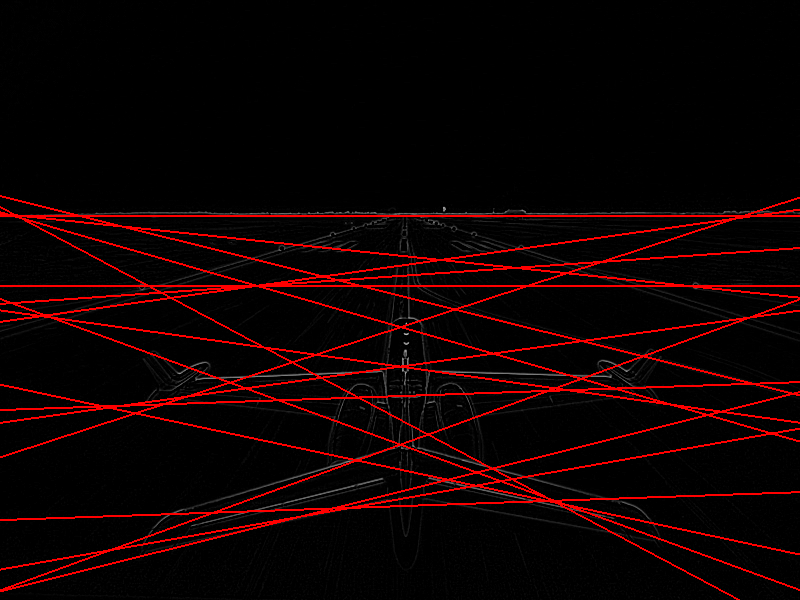
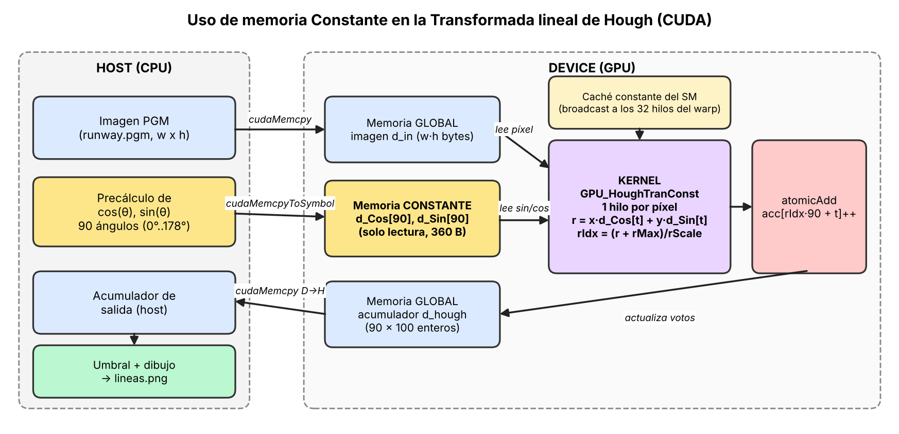
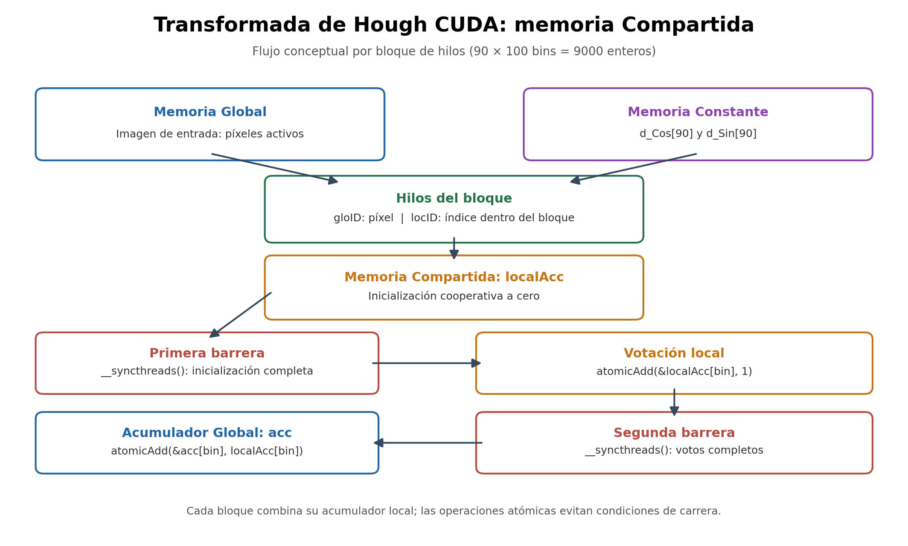

# Proyecto 3 — Transformada de Hough con CUDA

Proyecto académico de **Computación Paralela y Distribuida** de la Universidad del Valle de Guatemala (UVG). Implementa la Transformada Lineal de Hough para detectar líneas en imágenes de escala de grises, comparando tres estrategias de memoria en GPU NVIDIA: **Global**, **Global + Constante** y **Global + Constante + Compartida**.

## Características

- Implementación secuencial en CPU utilizada como referencia.
- Tres kernels CUDA independientes, con comparación de acumuladores CPU/GPU.
- Medición de tiempos del kernel mediante **CUDA events**.
- Detección de líneas mediante un umbral estadístico y visualización sobre la imagen original en PNG (versiones Constante y Compartida).
- Bitácoras de rendimiento y diagramas funcionales.

## Algoritmo

La Transformada de Hough representa una línea mediante su distancia al origen, `r`, y el ángulo de su normal, `θ`:

```text
r = x * cos(θ) + y * sin(θ)
```

Cada píxel activo vota por distintas combinaciones `(r, θ)` en un acumulador. Los bins con mayor cantidad de votos indican posibles líneas. La implementación utiliza **90 bins angulares** (incrementos de 2°) y **100 bins de distancia**, es decir, **9000 contadores**. Las coordenadas se trasladan para tomar el centro de la imagen como origen; la coordenada vertical se invierte para adoptar la orientación cartesiana.

### Variantes

| Versión | Archivo | Estrategia |
|---|---|---|
| Global | `houghBase.cu` | Imagen, trigonometría y acumulador en memoria Global. |
| Global + Constante | `houghConst.cu` | Senos y cosenos precalculados en arreglos `__constant__`, transferidos con `cudaMemcpyToSymbol`. |
| Global + Constante + Compartida | `houghShared.cu` | Además, acumulador `localAcc` por bloque en memoria Compartida; inicialización cooperativa, `__syncthreads()` y `atomicAdd` para votar y combinar resultados. |

El acumulador local tiene `90 × 100` enteros, aproximadamente **36 KB por bloque**.

## Requisitos

- GPU NVIDIA compatible con CUDA y memoria Compartida suficiente por bloque.
- Controlador NVIDIA y **CUDA Toolkit** con `nvcc`.
- `g++` y `make`.
- Linux o Ubuntu bajo WSL2 (entorno donde se probó el proyecto).

> **WSL2:** el controlador NVIDIA se instala en Windows; dentro de Ubuntu se instala el CUDA Toolkit, sin instalar un segundo controlador Linux.

Verificar el entorno:

```bash
nvidia-smi
nvcc --version
g++ --version
make --version
```

## Compilación

Desde la raíz del repositorio:

```bash
make
```

Para compilar una versión individual:

```bash
make hough
make houghConst
make houghShared
```

Para eliminar ejecutables y objetos compilados:

```bash
make clean
```

## Ejecución

La imagen de prueba incluida es `runway.pgm`.

**1. Solo memoria Global**

```bash
./hough runway.pgm
```

Muestra las 10 mediciones, su resumen estadístico y las diferencias entre los acumuladores CPU/GPU.

**2. Memoria Global + Constante**

```bash
./houghConst runway.pgm 10 2.0 resultados/lineas_constante.png
```

Sintaxis:

```text
./houghConst imagen.pgm [repeticiones] [k] [salida.png]
```

**3. Memoria Global + Constante + Compartida**

```bash
./houghShared runway.pgm 10 2.0 lineas_shared.png
```

Sintaxis:

```text
./houghShared imagen.pgm [repeticiones] [k] [salida.png]
```

En la versión Compartida, la salida se guarda automáticamente dentro de `resultados/`, incluso si el argumento solo contiene el nombre del archivo. Si la carpeta no existe, se crea.

En ambas versiones con visualización, `k` controla el umbral:

```text
umbral = promedio_del_acumulador + k * desviacion_estandar
```

El valor `k = 2.0` produjo 18 líneas detectadas en la imagen de prueba.

## Resultados experimentales

Mediciones realizadas con una **NVIDIA GeForce RTX 4070**, Ubuntu 24.04.4 LTS sobre WSL2. Los valores corresponden al **tiempo de ejecución del kernel**, no al tiempo total de lectura, copia de datos y escritura de imágenes.

| Versión | Repeticiones | Tiempo promedio | Aceleración frente a Global |
|---|---:|---:|---:|
| Global | 10 | 0.880922 ms | 1.00× |
| Global + Constante | 10 | 0.877856 ms | 1.003× |
| Global + Constante + Compartida | 10 | **0.365782 ms** | **2.41×** |

La versión Compartida redujo el tiempo promedio del kernel aproximadamente **58.5 %** respecto a Global. La diferencia entre Global y Global + Constante fue pequeña (aproximadamente 0.35 %), por lo que no debe interpretarse como una mejora estadísticamente concluyente sin pruebas adicionales.

También se conservan en `bitacora_constante.md` mediciones previas en **Tesla T4 (Google Colab)**; no deben compararse directamente con las de RTX 4070 como si fueran del mismo entorno.

### Validación

En las ejecuciones Global y Compartida se observaron **8994 de 9000 bins idénticos** frente a CPU. Los seis bins restantes diferían en **un voto**; el total fue de **12 456 540 votos** tanto en CPU como en GPU en la versión Compartida. La validación se reporta **con tolerancia**, no como igualdad exacta. Las discrepancias son compatibles con diferencias de redondeo y discretización de punto flotante.

### Evidencia visual

**Resultado con memoria Compartida**


**Resultado con memoria Constante, k = 2.0**



## Diagramas funcionales

**Memoria Constante**



**Memoria Compartida**



## Estructura del repositorio

```text
Proyecto-3-Paralela/
├── Makefile
├── .gitignore
├── houghBase.cu
├── houghConst.cu
├── houghShared.cu
├── runway.pgm
├── bitacora_global.md
├── bitacora_constante.md
├── bitacora_compartida.md
├── common/
│   ├── pgm.cpp
│   ├── pgm.h
│   ├── lines.cpp
│   ├── lines.h
│   └── stb_image_write.h
└── resultados/
    ├── diagrama_memoria_constante.png
    ├── diagrama_memoria_compartida.png
    ├── lineas_k2.png
    ├── lineas_k2_5.png
    └── lineas_shared.png
```

Los archivos `.o` y los ejecutables se generan al compilar y no es necesario versionarlos.

## Bitácoras y documentación

- [`bitacora_global.md`](bitacora_global.md): implementación Global, tiempos y validación.
- [`bitacora_constante.md`](bitacora_constante.md): memoria Constante, mediciones y análisis.
- [`bitacora_compartida.md`](bitacora_compartida.md): acumulador local, sincronización, operaciones atómicas y resultados.

## Consideraciones y limitaciones

- Las mediciones con CUDA events aíslan principalmente la ejecución del kernel; no representan el tiempo extremo a extremo.
- El rendimiento depende de la GPU, el tamaño de bloque, la imagen y la metodología de medición.
- Los resultados CPU/GPU se aceptaron con una tolerancia máxima de un voto en seis bins; conviene documentar la causa antes de exigir igualdad bit a bit.
- La creación de la carpeta de salida en `houghShared.cu` utiliza una llamada compatible con Linux/WSL2; puede requerir adaptación para compilación nativa en Windows.
- Las líneas detectadas dependen del umbral elegido; cambiar `k` modifica la cantidad de líneas dibujadas.

## Referencias

- NVIDIA. [CUDA C++ Programming Guide](https://docs.nvidia.com/cuda/cuda-c-programming-guide/).
- NVIDIA Developer Blog. [How to Implement Performance Metrics in CUDA C/C++](https://developer.nvidia.com/blog/how-implement-performance-metrics-cuda-cc/).
- Universidad del Valle de Guatemala. *Proyecto 3 — Computación Paralela y Distribuida* (enunciado del curso).

## Contexto académico

Este repositorio corresponde al **Proyecto 3** de Computación Paralela y Distribuida de la **Universidad del Valle de Guatemala**, centrado en comparar el uso de memoria Global, Constante y Compartida en CUDA para la Transformada Lineal de Hough.
